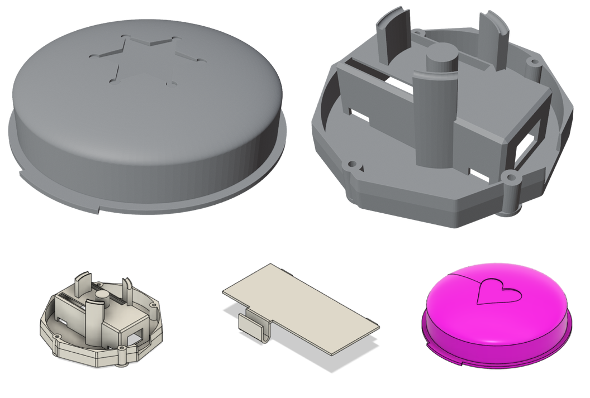

# attention-button

a physical button for my girlfriend at the time (2022). I 3d modeled and printed
the push button housing with an arduino nano 33 iot inside, soldered
with leds and a resistor. when she pressed it, the arduino hit an ifttt
webhook over wifi
and the lights in my room changed to her favorite color, so I knew she
was thinking about me and/or needed my attention while I was studying.

`models/` has the 3d-printed housing: the button itself (`button3-v4`)
and the base plate revisions (feb-mar 2023, filed under the codename
Project-Albatross at the time).

code folders are the real snapshots as I saved them, aka ButtonToLight:

- `ButtonToLED`: wiring warmup, button toggles an led
- `ButtonToLightV1`: first wifi version, fires the webhook
- `ButtonToLightV2`: second revision
- `ButtonToLightV3 DEBUG` / `FINAL`: last revision (aug 2023)

wifi credentials and the ifttt key lived in `arduino_secrets.h`, which
stays out of this repo (see `arduino_secrets.h.example`). credentials in
the old sketches were scrubbed before publishing.

archived from my old windows drive in 2026.
